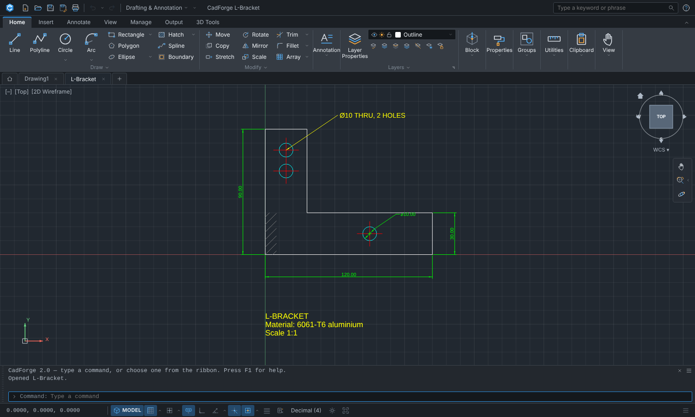
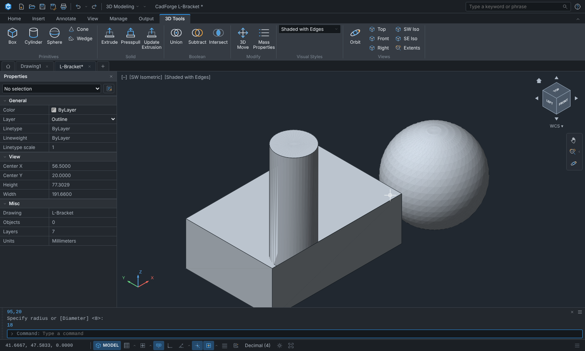

# CadForge 2.0

A CAD application with an AutoCAD-style interface and command set: 2D drafting, annotation, hatching,
blocks and external references, layers, paper-space layouts, raster images, AutoLISP, 3D solid modelling, DXF
import/export and plotting to PDF/SVG/PNG.

It exists in two forms that share one design:

* **Rust** (`crates/`, the maintained version): a Cargo workspace whose UI is built with
  [egui](https://github.com/emilk/egui). It runs as a **native desktop app** and compiles to **WebAssembly** for the
  browser (`dist-web/`).
* **JavaScript** (`src/`): the original browser version, built into **one self-contained file,
  `CadForge.html`**. It is no longer extended; its modules and unit tests are the specification the Rust code was
  ported from.

How close is it to AutoCAD? [docs/BENCHMARK.md](docs/BENCHMARK.md) scores it against a written rubric: **66.9 / 100**
today, with every gap listed. That is a self-assessment (AutoCAD cannot be run here), not a measurement against the
product.




## What it does

* **Interface modelled on AutoCAD** — application menu, Quick Access Toolbar, InfoCenter search, ribbon with
  tabs/panels/slide-outs/split buttons and contextual *Hatch Creation* tab, document tabs and Start page,
  ViewCube, navigation bar, dynamic input, docked command line with clickable options and autocomplete, status bar
  (Grid, Snap, Dynamic Input, Ortho, Polar, Object Snap, Object Snap Tracking, Lineweight, Quick Properties),
  Properties palette, Layer Properties Manager, Tool Palettes, F2 text window, dark and light themes.
* **314 commands** with AutoCAD names, aliases (`L`, `C`, `TR`, `O`, `M`, `CO`...) and prompts — see
  [docs/COMMANDS.md](docs/COMMANDS.md). Object snaps (END MID CEN NOD QUA INT INS PER TAN NEA) with tracking, polar
  and ortho, FROM / M2P, direct distance entry, pick-first selection, window/crossing/fence/polygon selection, grips,
  transparent commands, command aliases you can edit (`ALIASEDIT`), scripts (`SCRIPT`).
* **2D**: line, polyline (arcs, widths), circle (all variants), arc (all variants), rectangle, polygon, ellipse,
  spline, point, construction line, ray, donut, hatch with island detection, boundary, text/multiline text with an
  in-place editor, linear/aligned/angular/radius/diameter dimensions, leaders, blocks and groups, trim, extend,
  fillet, chamfer, offset, array, mirror, stretch, break, join, lengthen, explode, polyline edit, match properties.
* **3D solids** (triangle meshes): `BOX`, `CYLINDER`, `CONE`, `SPHERE`, `WEDGE`, `EXTRUDE` (holes, taper, start
  elevation, add/subtract with linked history), `PRESSPULL`, `UNION`, `SUBTRACT`, `INTERSECT` (computed on a worker
  thread), `3DMOVE`, `MASSPROP`, orbit and ViewCube, 2D/Wireframe/Hidden/Shaded visual styles, OBJ and STL export.
* **Beyond 2D drafting**: paper-space layouts with viewports (`LAYOUT`, `MVIEW`, `VPCLIP`, `PAGESETUP`), tables,
  multileaders, attributes (`ATTDEF`, `ATTEXT`, `DATAEXTRACTION`), block editing in place (`REFEDIT`, `BEDIT`), external references
  taken from open drawings with `XCLIP`, raster images (`IMAGEATTACH`, `IMAGECLIP`, `IMAGEADJUST`), and an
  **AutoLISP** interpreter (`APPLOAD`, the `VLISP` console, `(command ...)`, `c:` commands and `*error*`).
* **Annotation**: multiline text interprets AutoCAD's inline codes (bold / italic, underline / overline / strike-through,
  colour, height, stacked fractions, `%%d %%p %%c`) and keeps them through DXF; `PLOTSTYLE` loads a `.ctb` plot style table
  that sets colour, lineweight and screening when plotting; `VPLAYER` freezes layers (and overrides their colour, linetype,
  lineweight) per layout viewport.
* **Large drawings**: picking, window selection, snapping and screen culling use a grid index (100 000 objects: a pick
  takes microseconds instead of 30 ms).
* **Working with files**: drag a file onto the window (drawings open, pictures attach, `.lsp` / `.scr` load, `.lin` /
  `.pat` add linetypes and hatch patterns); **autosave** every `SAVETIME` minutes with recovery of unsaved drawings after
  a crash (`DRAWINGRECOVERY`); `PUBLISH` writes every sheet as one multi-page PDF; `ARCHIVE` / `ETRANSMIT` pack a
  drawing with its pictures and a report into a ZIP; `-LINETYPE` Load and `LOADPAT` read acad.lin / acad.pat files.
* **Files**: CadForge JSON, **DXF R2000 export** (validated with `ezdxf`), tolerant **DXF import** (including DXFs written by
  other tools, and **binary DXF**, which `-DXFOUT` also writes), **plot to PDF / SVG / PNG** with paper size, scale, lineweights and monochrome options and a live preview.

## Rust app: build, run, test

```sh
cargo run -p cadforge-app --release --bin cadforge   # native desktop app
cargo test --workspace                               # core / ops / engine / render / io tests (no GUI needed)
cargo clippy --workspace --all-targets               # lints: no errors; style warnings remain
cargo run -q -p cadforge-engine --example commands_doc > docs/COMMANDS.md   # regenerate the command reference
cargo run -q -p cadforge-engine --example parity     # command coverage vs. the AutoCAD inventories (-- --missing, --json)
python3 tools/benchmark/score.py --check             # verify every benchmark credit still points at real code / a test
python3 tools/benchmark/score.py --write             # regenerate docs/BENCHMARK.md
tools/package.sh                                     # release build -> dist/ (tar.gz, and a .deb on Debian-like systems; zip on Windows)
tests/package/check.sh                               # check what tools/package.sh produced
tools/build-web.sh                                   # WebAssembly build -> dist-web/ (serve it over http)
tools/build-web.sh dev                               # faster, less optimised wasm build
node tests/web/run.mjs                               # drive the wasm build in headless Chromium (Playwright)
node tests/web/tour3.mjs out/                        # screenshot tours (tour, tour2, tour3, tour4)
node tools/gen-app-data.mjs                          # regenerate crates/cadforge-app/assets/{icons,ribbon}.json (ribbon model)
```

CI (`.github/workflows/ci.yml`) runs the tests, clippy, the benchmark evidence check and the wasm build on Linux and builds
the packages on Linux, macOS and Windows; pushing a `v*` tag runs `release.yml`, which attaches the packages to a GitHub
release. The dev profile keeps only line tables as debug info (`Cargo.toml`): full debug info made the many test
binaries take tens of GB.

The wasm build needs the `wasm32-unknown-unknown` target and `wasm-bindgen-cli`
(`rustup target add wasm32-unknown-unknown && cargo install wasm-bindgen-cli`). Files are opened and saved through the
browser in the wasm build (hidden file input / download) and through an in-app file browser natively. Settings and
recent files persist in `localStorage` (web) or a JSON file in the user's config directory (native).

## JavaScript app: build, run, test

```sh
npm install          # esbuild only
npm run build        # -> CadForge.html (add --min for a minified build)
npm test             # unit tests (Node 22+): geometry, commands, DXF, plotting, solids
npm run test:browser # drives the real UI in headless Chromium (needs Playwright + Chromium)
```

A lint configuration is in `eslint.config.mjs`. The command reference is generated from the Rust registry (see above).

## Layout

Rust workspace:

```
crates/cadforge-core     geometry, entities, drawing database + undo, dimensions, hatch, text, solids (mesh/CSG/earcut), DXF & project io
crates/cadforge-render   scene -> backend-independent draw ops; plot layout; PDF / SVG writers; PNG rasteriser (tiny-skia)
crates/cadforge-engine   async command runtime (no executor crate), snapping, selection, system variables, command registry, ~160 commands, test `Sim`
crates/cadforge-app      egui front end: ribbon, viewport + ViewCube, command line, palettes, dialogs, file/platform glue (native + wasm)
tools/build-web.sh       wasm32 build + wasm-bindgen into dist-web/
tools/benchmark          AutoCAD command inventories, rubric and score.py (see docs/BENCHMARK.md)
tools/extend-ui.py       adds ribbon panels / icons for newer commands to the generated app data
tests/web                headless-Chromium tests and screenshot tours for the wasm build
tests/dxf                ezdxf-written corpus (make-corpus.py) that the DXF reader and writer are tested against
```

JavaScript version:

```
src/core      DOM-free model: geometry, entities, drawing database, styles, dimensions, hatch patterns
src/ops       trim / extend / offset / fillet / boundary detection algorithms
src/engine    command runtime (prompts, snapping, selection, grips), system variables, registry, camera
src/commands  AutoCAD commands, one module per group
src/solid     meshes, extrusion, triangulation, CSG booleans (+ worker), picking
src/io        DXF reader/writer, project files, PDF/SVG writers, plot layout
src/render    canvas renderer, overlay (preview, snaps, grips), solid shading
src/ui        the interface (ribbon, palettes, dialogs, command line...)
tests         unit tests (no browser) and browser tests
legacy        the previous single-file version, kept for reference
```

The core, ops, engine, commands, solid and io layers have no DOM dependency; the unit tests drive them headlessly
with a scripted "user" (`tests/unit/sim.js` in JS, `cadforge_engine::sim::Sim` in Rust).

## Limitations

No DWG (DXF only), no B-rep solids (meshes only: no fillet or face editing of solids), no surfaces or meshes, no
rendering, no sheet sets, no dynamic blocks, no OLE objects or PDF/DGN underlays, no plot style editor (named `.stb`
tables load but cannot be applied), MTEXT has no columns, tabs or font choice, there are 13 built-in hatch patterns
(more load from `.pat` files) and a single text font. External references are taken from drawings that are already open
(no reload from a path).

DXF notes: raster images are written as references to the image file (pixels are not embedded in the DXF), and
`XCLIP` boundaries are display-only and are not written to DXF. See `HANDOFF.md` and `docs/BENCHMARK.md` for the full
list.

The egui build draws text with Liberation Sans (SIL OFL) and Inter, shipped in `crates/cadforge-app/assets/fonts`.

Third-party: `csg.js` by Evan Wallace (MIT, `CSG-LICENSE.txt`), vendored in `src/solid/vendor` and ported to Rust in
`cadforge-core`. Ear-clipping triangulation follows Mapbox's earcut (ISC); the Rust UI uses the `earcutr` crate.
